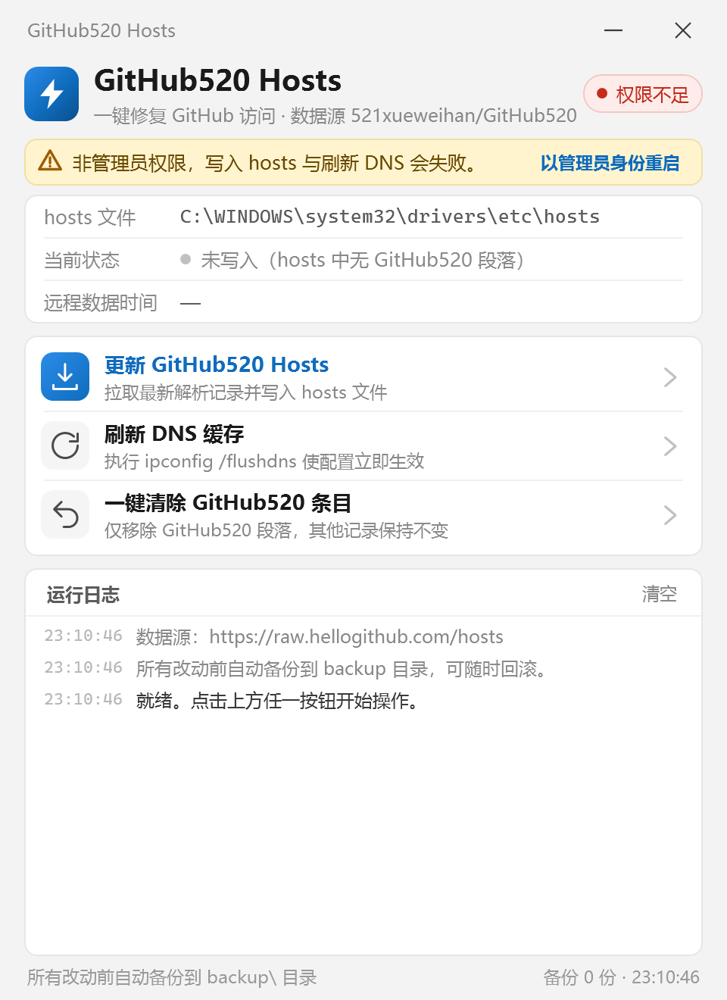

# GitHub520 的Hosts手动一键整合工具

一个用于 Windows 11/10 的桌面小工具，把 GitHub520 提供的最新 GitHub 解析记录一键写入系统 hosts，并在每次改动前自动备份。

> **重要声明（请先读）**
>
> 1. 本项目是**独立的第三方工具**，与 GitHub520 原作者及 HelloGitHub **无任何官方关联**，未获其背书。
> 2. 数据源 `https://raw.hellogithub.com/hosts` 由 GitHub520 项目自行维护。按其仓库公告，**该服务于 2026-12-31 到期**；若届数据源不可用，本工具将无法更新，请留意原仓库最新状态。
> 3. 本工具**非商业、免费使用**。数据源采用 CC BY-NC-ND 4.0 许可，详见文末「致谢与许可」。

## 界面预览



---

## 功能

| 功能 | 说明 |
| --- | --- |
| 更新 GitHub520 Hosts | 从官方地址拉取最新解析记录，替换 hosts 中旧的 GitHub520 段落（幂等，不会重复堆叠），然后自动刷新 DNS 缓存 |
| 刷新 DNS 缓存 | 单独执行 `ipconfig /flushdns` |
| 一键清除 GitHub520 条目 | 只移除 GitHub520 段落，**其他自定义记录一律不动** |

其他特性：

- 改动前自动备份到 `backup/`，首次运行额外保存一份 `hosts.original.bak` 作为回退基准。
- 保留原 hosts 的编码与 BOM，按标记精确替换，不破坏你自己添加的内容。
- 更新后校验条目数，写入失败或内容异常会给出中文错误提示。
- 固定 8:11 窗口比例、不可拉伸；高 DPI 屏幕下自动适配。
- 启动即显示权限状态；非管理员时提供「以管理员身份重启」按钮（写入 hosts 需要管理员权限）。

## 下载版本

| 文件 | 大小 | 说明 |
| --- | --- | --- |
| `GitHub520Hosts（NET10）.exe` | 约 126 MB | **自包含版**，内置 .NET 10 运行时，双击即用，无需安装任何依赖 |
| `GitHub520Hosts.exe` | 约 290 KB | **轻量版**，需先安装 [.NET 10 桌面运行时](https://dotnet.microsoft.com/download/dotnet/10.0) |

两版功能完全一致，按需选择。

## 使用

1. 下载上面任一版本，放到任意一个**你有写入权限**的目录（例如桌面或文档目录）。
2. 双击运行。程序会在 UAC 提示下请求管理员权限；若选择「否」，仍可使用，但写入 hosts 与刷新 DNS 会失败，界面顶部会有黄色提示。
3. 点击「更新 GitHub520 Hosts」即可完成配置；需要撤销时点击「一键清除 GitHub520 条目」。
4. 需要回滚时，手动把 `backup/` 里对应的 `.bak` 文件内容复制回系统 hosts 文件。

系统 hosts 文件路径：`C:\Windows\System32\drivers\etc\hosts`

### 运行环境

- Windows 10 / Windows 11（x64）
- 自包含版无需安装 .NET 运行时；轻量版需安装 .NET 10 桌面运行时（Microsoft.WindowsDesktop.App 10.0）
- 管理员权限（写入 hosts / 刷新 DNS 时需要）

## 隐私与安全

- 程序只向 `https://raw.hellogithub.com/hosts` 发起读取请求，不上传任何本机信息，不含遥测。
- 所有备份、日志都写在 exe 同目录的 `backup/`、`logs/` 下，不向外发送。
- 修改 hosts 属于系统级操作：杀毒软件可能提示或拦截 hosts 保护，请自行判断是否放行；操作前建议保留系统还原点。
- 未签名的 exe 首次运行可能触发 Windows SmartScreen 警告，选择「更多信息 → 仍要运行」即可（请确认你下载来源可信）。

## 常见问题

- **提示「权限不足」**：点击顶部「以管理员身份重启」，或右键 exe 选「以管理员身份运行」。
- **DNS 刷新失败**：需要管理员权限；也可手动在管理员命令提示符执行 `ipconfig /flushdns`。
- **更新后仍未生效**：部分浏览器会缓存 DNS，重启浏览器或重试；必要时重启机器。
- **exe 双击没反应**：轻量版请先安装 .NET 10 桌面运行时；自包含版不依赖外部运行时，但首次启动需解压内置运行时，可能稍等几秒。两版均需 x64 Windows 10/11。

## 从源码编译

需要 .NET SDK 10.0（本项目目标框架 `net10.0-windows`）。自包含版：

```bash
dotnet publish src/GitHub520Hosts.csproj -c Release -r win-x64 \
  --self-contained true -p:PublishSingleFile=true \
  -p:IncludeNativeLibrariesForSelfExtract=true -p:EnableWindowsTargeting=true \
  -o publish/
```

轻量版（需外部 .NET 10 桌面运行时）：

```bash
dotnet publish src/GitHub520Hosts.csproj -c Release -r win-x64 \
  --self-contained false -p:PublishSingleFile=true -p:EnableWindowsTargeting=true \
  -o publish/
```

源码位于 `src/`，核心逻辑在 `src/HostsManager.cs`。

隐藏的自检参数（开发用，普通用户无需关心）：
`--selftest <hosts副本>`、`--uitest <hosts副本>`、`--screenshot <png>`、`--size WxH`。

## 致谢与许可

本工具的解析数据来自 [GitHub520](https://github.com/521xueweihan/GitHub520)（作者 521xueweihan / HelloGitHub），数据源地址 `https://raw.hellogithub.com/hosts`。

该数据源作品采用 [**署名-非商业性使用-禁止演绎 4.0 国际（CC BY-NC-ND 4.0）**](https://creativecommons.org/licenses/by-nc-nd/4.0/deed.zh) 许可。据此：

- 本项目仅**在运行时原样读取**上述公开数据源并写入用户本机 hosts，**不在仓库中打包、修改或再分发 hosts 数据本身**；
- 本项目为免费、非商业用途；如需商用或改编数据内容，请另行联系原作者取得授权；
- 在此署名并链接原项目，保留原许可声明。

本工具自身的源代码采用 [MIT 许可](LICENSE)（见仓库根目录 `LICENSE` 文件；其中附有关于数据源 CC BY-NC-ND 许可的 NOTICE 声明，二者独立适用）。

## 免责声明

本工具按「现状」提供，不提供任何明示或暗示的担保。修改系统 hosts 可能影响网络访问，请自行评估风险并务必保留备份。因使用本工具造成的任何损失，作者不承担责任。
